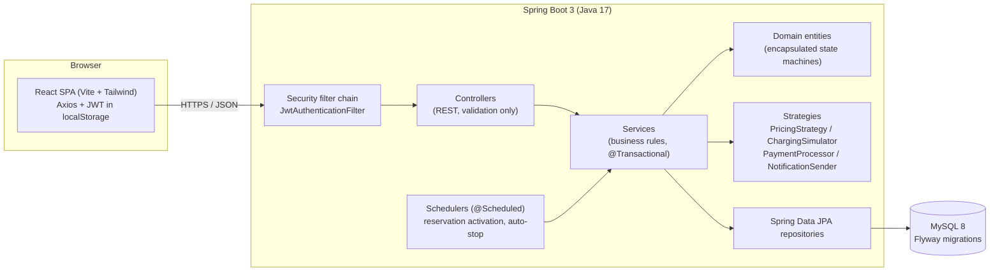
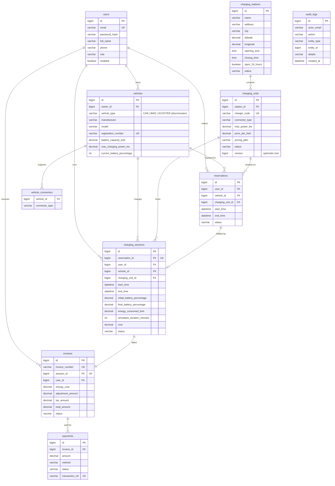
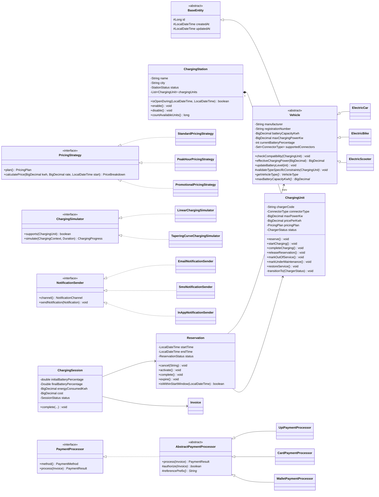

# VoltX – Architecture & Design

This document is the Phase 1–3 output: system architecture, folder structure,
database design, the UML class diagram and the mapping of the four OOP pillars
to real classes. All diagrams are Mermaid, so they render on GitHub and can be
regenerated (see `docs/UML.md` for the full UML set).

## 1. System architecture

VoltX is a **modular monolith**: one Spring Boot application exposing a REST API,
one React single-page application, one MySQL database.



Request flow: `Controller → Service (interface) → ServiceImpl → Entity methods + Strategies → Repository`.
Controllers never touch repositories; entities never touch Spring.

### Key design decisions

| Decision | Why |
| --- | --- |
| Modular monolith, not microservices | One deployable is enough for this domain and far easier to explain and run. |
| Rich domain entities (state changes via methods like `ChargingUnit.reserve()`) | Puts invariants next to the data (encapsulation); controllers cannot set a status directly. |
| Strategy interfaces for pricing, simulation, payment, notification | New pricing model = one new class, no edits to billing code (Open/Closed). |
| Charging progress computed **on the server** from elapsed time | The frontend only polls; it never decides energy or cost. |
| Pessimistic row lock on the charger while booking | Two users booking the same slot at the same instant cannot both succeed. |
| Flyway migrations | Schema is versioned, reproducible, and identical on every machine. |
| Stateless JWT | No server sessions; the SPA sends `Authorization: Bearer <token>`. |

### Simulation (honest scope)

No real hardware, metering or payment gateway is involved:

* **Charging** – a `ChargingSimulator` turns elapsed time into delivered energy. Time is
  accelerated (`voltx.simulation.time-multiplier`, default 60 ⇒ 1 real second = 1 simulated minute)
  so a session can be demonstrated in under a minute.
* **Payment** – `PaymentProcessor` implementations (UPI, card, wallet) generate a transaction
  reference and mark the invoice paid.
* **Notifications** – email / SMS / in-app senders log the message asynchronously.

## 2. Folder structure

```
oops_proj/
├── backend/                         Spring Boot application (Maven)
│   └── src/main/java/com/voltx/
│       ├── VoltXApplication.java
│       ├── config/                  OpenAPI, async, CORS, demo data seeder, properties
│       ├── controller/              REST controllers (customer + admin)
│       ├── dto/request|response/    API records — never expose entities
│       ├── entity/                  JPA entities (Vehicle hierarchy, ChargingUnit, ...)
│       ├── enums/                   ChargerStatus (with transition table), ConnectorType, ...
│       ├── exception/               VoltXException hierarchy + GlobalExceptionHandler
│       ├── mapper/                  Entity → DTO mapping
│       ├── repository/              Spring Data JPA interfaces
│       ├── security/                JWT service, filter, SecurityConfig, CurrentUser
│       ├── service/                 Service interfaces
│       │   └── impl/                Implementations (@Transactional business logic)
│       ├── strategy/
│       │   ├── pricing/             PricingStrategy + Standard / PeakHour / Promotional
│       │   ├── payment/             PaymentProcessor + AbstractPaymentProcessor + UPI/Card/Wallet
│       │   └── notification/        NotificationSender + Email / Sms / InApp
│       ├── simulator/               ChargingSimulator + Linear (AC) / TaperingCurve (DC)
│       ├── scheduler/               Reservation & session background jobs
│       └── util/                    EnergyCalculator (overloads), AppClock
│   └── src/main/resources/
│       ├── application.yml
│       └── db/migration/            V1__schema.sql, V2__seed_stations.sql
├── frontend/                        React + Vite + TypeScript + Tailwind
│   └── src/
│       ├── api/                     Axios client + typed endpoint functions
│       ├── components/              UI kit (Button, Card, Modal, StatusBadge, ...)
│       ├── context/                 AuthContext, ToastContext
│       ├── layouts/                 Public / App shell with role-based sidebar
│       ├── pages/                   customer/*, admin/*, public pages
│       └── types/                   Shared TypeScript types
└── docs/                            ARCHITECTURE, UML, OOP_EXPLANATION, VIVA_PREPARATION
```

## 3. Database design

Nine core tables plus one collection table (`vehicle_connectors`, the normalised
list of connector types a vehicle supports).



Indexes: `reservations(charging_unit_id, start_time, end_time)` for overlap checks,
`charging_sessions(user_id, status)`, `charging_stations(city)`, `audit_logs(created_at)`.
Cascades: deleting a station cascades to its chargers; deleting a vehicle cascades to its
connector rows only (a vehicle with history cannot be deleted — the service blocks it).

## 4. UML class diagram (domain core)



## 5. OOP pillar mapping (summary)

| Pillar | Where | What to show in the viva |
| --- | --- | --- |
| **Encapsulation** | `ChargingUnit`, `ChargerStatus`, `Reservation`, `ChargingSession`, `Vehicle.updateBatteryLevel` | All fields private, no public status setter; `reserve()/startCharging()/completeCharging()` go through `transitionTo()` which consults the transition table in `ChargerStatus`. |
| **Inheritance** | `Vehicle` → `ElectricCar/ElectricBike/ElectricScooter`; `BaseEntity`; `AbstractPaymentProcessor` → UPI/Card/Wallet; `VoltXException` → `ResourceNotFoundException` → `StationNotFoundException` … | Shared state/behaviour lives once in the parent. |
| **Polymorphism (runtime)** | `vehicle.checkCompatibility(unit)` calls the subclass's `validateTypeSpecificConstraints`; `PricingStrategy.calculatePrice`; `ChargingSimulator.simulate`; `NotificationSender.sendNotification`; `PaymentProcessor.process` | The service holds an interface/parent reference; the JVM picks the override at runtime. |
| **Polymorphism (compile-time)** | `EnergyCalculator.energyConsumed(...)` ×3 overloads, `NotificationService.notify(...)` ×2 overloads, `AuditService.record(...)` ×2 overloads | Same name, different parameter lists, chosen by the compiler. |
| **Abstraction** | Interfaces `PricingStrategy`, `ChargingSimulator`, `PaymentProcessor`, `NotificationSender`, all `*Service` interfaces, `StationRepository`; abstract classes `Vehicle`, `AbstractPaymentProcessor`, `BaseEntity`, `VoltXException` | Callers depend on *what* (interface), not *how* (implementation). |

The detailed, class-and-method level explanation is in `docs/OOP_EXPLANATION.md`.
