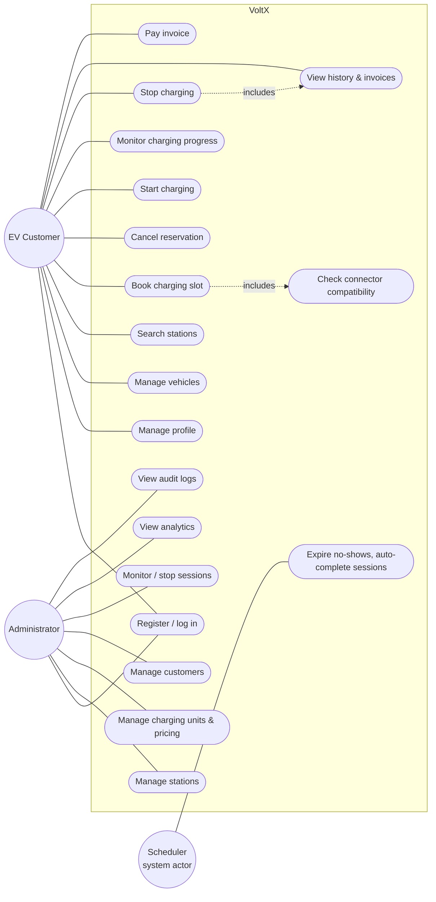
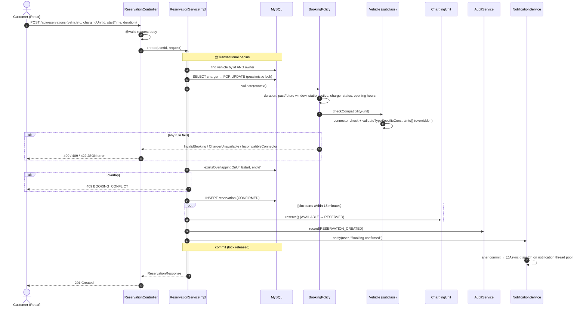
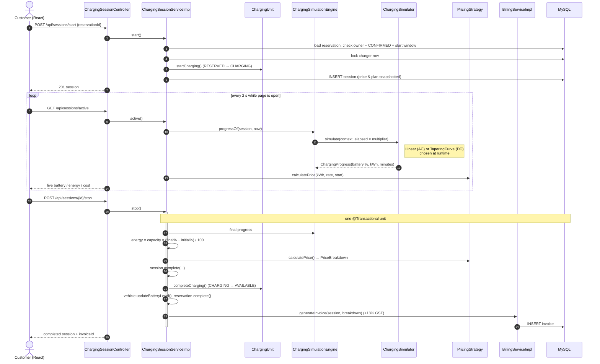
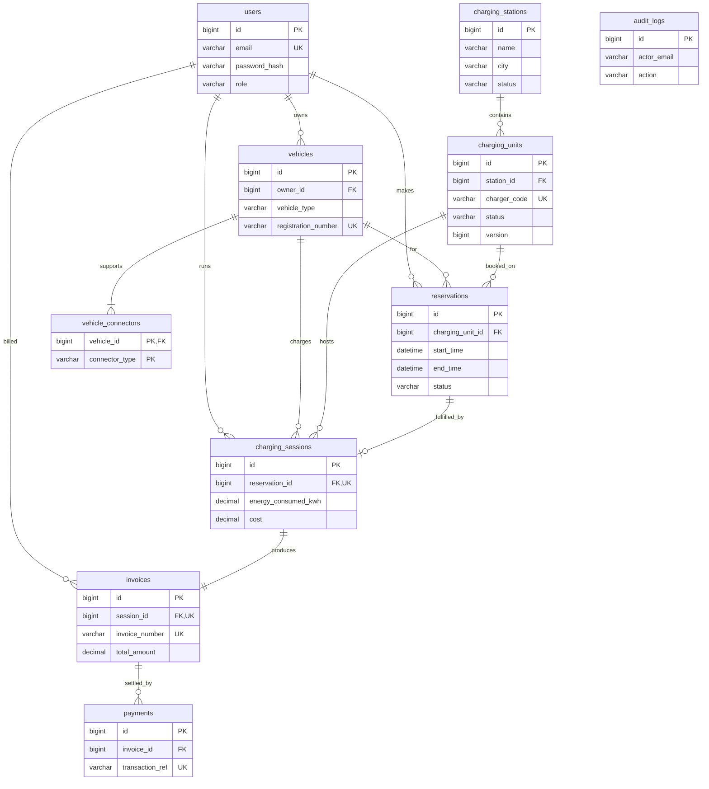
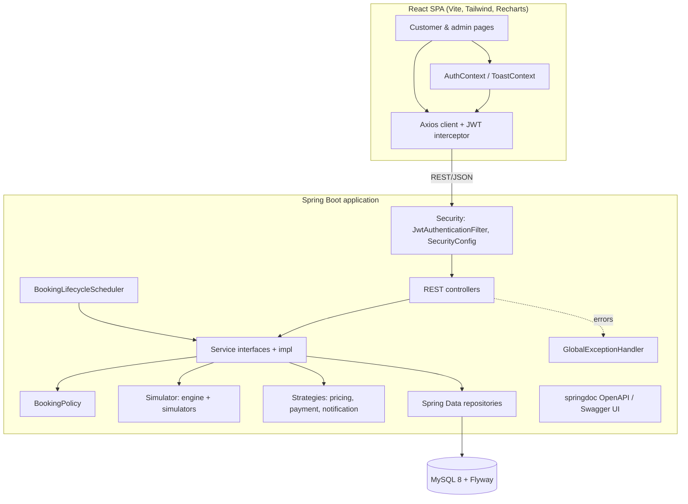

# VoltX – UML Diagrams

All diagrams are [Mermaid](https://mermaid.js.org) source. GitHub renders them directly; to export
images, paste a block into https://mermaid.live or run `npx @mermaid-js/mermaid-cli -i UML.md`.

## 1. Use-case diagram

## 2. Class diagram (domain + strategies)

```mermaid
classDiagram
    direction TB
    class BaseEntity { <<abstract>> -Long id -LocalDateTime createdAt -LocalDateTime updatedAt }
    class User { -String email -String passwordHash -Role role -boolean enabled +updateProfile() +disable() }
    class Vehicle {
        <<abstract>>
        -BigDecimal batteryCapacityKwh
        -int currentBatteryPercentage
        -Set~ConnectorType~ supportedConnectors
        +checkCompatibility(ChargingUnit)
        +findCompatibilityIssue(ChargingUnit) Optional~String~
        +effectiveChargingPower(BigDecimal) BigDecimal
        +defaultTargetPercentage(ChargingUnit) int
        #validateTypeSpecificConstraints(ChargingUnit)*
        +getVehicleType()* VehicleType
    }
    class ElectricCar { +validateTypeSpecificConstraints() +defaultTargetPercentage() }
    class ElectricBike { +validateTypeSpecificConstraints() }
    class ElectricScooter { +validateTypeSpecificConstraints() }
    class ChargingStation { -String city -StationStatus status +isOpenDuring() +enable() +disable() }
    class ChargingUnit { -ChargerStatus status -PricingPlan pricingPlan +reserve() +startCharging() +completeCharging() +releaseReservation() +markOutOfService() +restoreService() }
    class ChargerStatus { <<enumeration>> AVAILABLE RESERVED CHARGING OUT_OF_SERVICE MAINTENANCE +canTransitionTo() }
    class Reservation { -LocalDateTime startTime -LocalDateTime endTime -ReservationStatus status +cancel() +activate() +complete() +expire() }
    class ChargingSession { -double initialBatteryPercentage -Double finalBatteryPercentage -BigDecimal energyConsumedKwh +complete() }
    class Invoice { -BigDecimal subtotal -BigDecimal taxAmount -BigDecimal totalAmount +issue()$ +markPaid() }
    class Payment { -PaymentMethod method -PaymentStatus status -String transactionRef }
    class AuditLog { -String actorEmail -AuditAction action }

    BaseEntity <|-- User
    BaseEntity <|-- Vehicle
    BaseEntity <|-- ChargingStation
    BaseEntity <|-- ChargingUnit
    BaseEntity <|-- Reservation
    BaseEntity <|-- ChargingSession
    BaseEntity <|-- Invoice
    BaseEntity <|-- Payment
    Vehicle <|-- ElectricCar
    Vehicle <|-- ElectricBike
    Vehicle <|-- ElectricScooter
    User "1" --> "*" Vehicle : owns
    ChargingStation "1" *-- "*" ChargingUnit
    ChargingUnit --> ChargerStatus
    Reservation --> User
    Reservation --> Vehicle
    Reservation --> ChargingUnit
    ChargingSession "0..1" --> "1" Reservation
    Invoice "1" --> "1" ChargingSession
    Payment "*" --> "1" Invoice

    class PricingStrategy { <<interface>> +plan() +calculatePrice(kwh, rate, start) PriceBreakdown }
    PricingStrategy <|.. StandardPricingStrategy
    PricingStrategy <|.. PeakHourPricingStrategy
    PricingStrategy <|.. PromotionalPricingStrategy

    class ChargingSimulator { <<interface>> +supports(ctx) +simulate(ctx, elapsed) ChargingProgress }
    ChargingSimulator <|.. LinearChargingSimulator
    ChargingSimulator <|.. TaperingCurveChargingSimulator
    ChargingSimulationEngine o-- ChargingSimulator

    class PaymentProcessor { <<interface>> +method() +process(Invoice) PaymentResult }
    class AbstractPaymentProcessor { <<abstract>> +process(Invoice) #authorize(amount)* #referencePrefix()* }
    PaymentProcessor <|.. AbstractPaymentProcessor
    AbstractPaymentProcessor <|-- UpiPaymentProcessor
    AbstractPaymentProcessor <|-- CardPaymentProcessor
    AbstractPaymentProcessor <|-- WalletPaymentProcessor

    class NotificationSender { <<interface>> +channel() +sendNotification(Notification) }
    NotificationSender <|.. EmailNotificationSender
    NotificationSender <|.. SmsNotificationSender
    NotificationSender <|.. InAppNotificationSender

    class StrategyRegistry~K,S~ { +get(K) S +keys() Set~K~ }
```

## 3. Sequence diagram – booking a charger

## 4. Sequence diagram – charging session

## 5. Entity-relationship diagram

## 6. Component diagram

